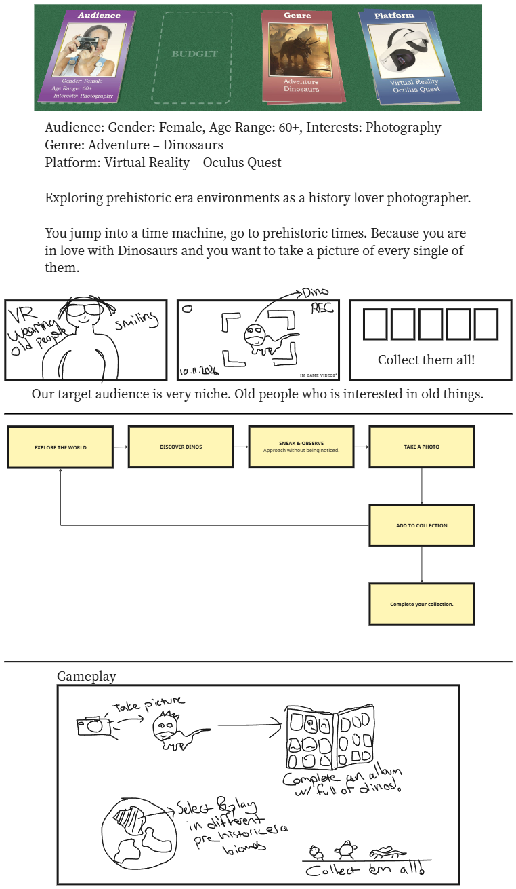

# 🦕 Dino Lens

> An **interactive game design document** for a VR photography adventure. Jump into a time machine, sneak up on dinosaurs, and fill your album with the perfect shots. 📸

▶️ **Open the design doc:** [https://azizkerim.github.io/DinoLens/](https://azizkerim.github.io/DinoLens/)

No install, no account, no downloads. It runs right in your browser. 💻

## 🙌 Credits

Designed and built by **Kerim** 🎮 as a class workshop project, made with the help of **Claude** 🤖 inside VS Code.
Course: Agentic Prototyping for Designers by Stone Librande

---

## 🃏 The Brief

| Card | Value |
|------|-------|
| 👵 Audience | Female, 60+, interested in photography |
| 🦖 Genre | Adventure – Dinosaurs |
| 🥽 Platform | Virtual Reality – Oculus Quest |

You are a history-loving photographer. You travel to prehistoric times because you are in love with dinosaurs, and you want to take a picture of every single one of them.

---

## 🔁 Core Loop

**Explore the world → Discover dinos → Sneak & observe → Take a photo → Add to collection → Complete your collection**

On the page, click any step to read about it. While you play the demo, the active step lights up.

---

## 🕹️ Try It: Sneak & Photo

1. 🌍 **Pick a biome** on the planet: Jurassic Jungle, Cretaceous Plains, Misty Swamp or Volcanic Valley.
2. 🥽 **VR onboarding** shows the controls. The right hand aims the camera and the left trigger takes the photo.
3. 🐾 **Move slowly** near a dinosaur. Fast moves fill its awareness meter, and it runs away when the meter is full.
4. 📸 **Click** to take a photo. You get up to 3 stars:
   - ⭐ The dino is in the frame
   - ⭐ The dino is centered
   - ⭐ The dino is calm
5. 📒 Your best shot of each species goes into the **Album**. Collect all 4: Brachiosaurus, Triceratops, Stegosaurus and the very shy Velociraptor.

---

## 📁 Project Structure

```
index.html   # 🌐 The whole design doc and demo in one file (what GitHub Pages serves)
image.png    # ✏️ The original whiteboard sketch
```

Built with plain **HTML, CSS and JavaScript**, with no frameworks and no libraries. 🚫📦

## 🛠️ Run Locally

```bash
git clone https://github.com/AzizKerim/DinoLens.git
```

Then open `index.html` in your browser. 🎉

## ✏️ Original Sketch


